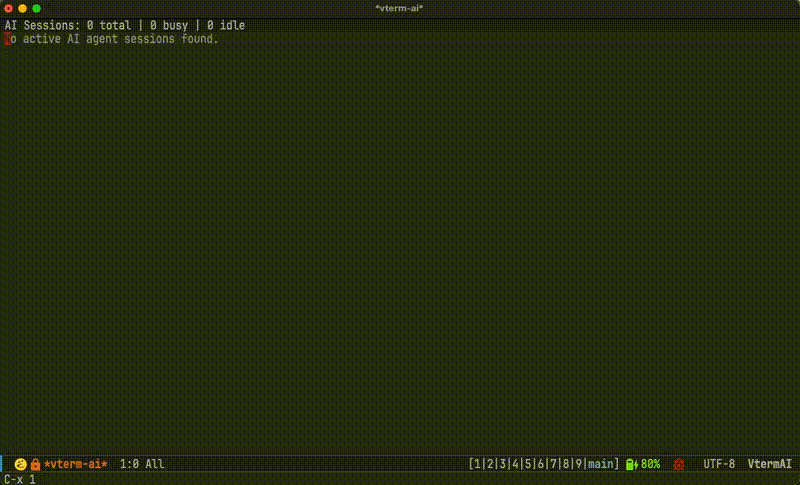

# vterm-ai



## Overview

vterm-ai is an Emacs package that provides a dashboard to monitor AI coding agent sessions running in vterm buffers.

It periodically collects session information and displays status, model, working directory, and the last human prompt for each agent — all in a single, lightweight buffer.

## Features

- List all active AI agent sessions with their current state
- Status display: `ASKING` (waiting for user response), `DONE` (finished a turn you have not acted on), `IDLE` (waiting for prompt), `BUSY` (working), `ERROR`, `RUNNING` (process active, state unknown), with time spent in the state
- Show what the agent reports it is doing (`Now:`) and Claude subagents, from the agent's own OSC 7501 status reports
- Show session title, model name, working directory, and last human prompt
- Jump to the corresponding vterm buffer with `RET`
- Asynchronous data collection — does not block Emacs
- Extensible provider architecture for supporting multiple agent types

## Requirements

- Emacs 27.1+
- [vterm](https://github.com/akermu/emacs-libvterm)
- [Claude Code](https://docs.anthropic.com/en/docs/claude-code) CLI (for the Claude provider)
- [Codex](https://openai.com/index/introducing-codex/) CLI + `sqlite3` on `PATH` (for the Codex provider, experimental — see below)
- [Cursor](https://www.cursor.com/) CLI + `sqlite3` on `PATH` (for the Cursor provider, experimental — see below)
- [OpenCode](https://opencode.ai/) CLI + `sqlite3` on `PATH` (for the OpenCode provider, experimental — see below)
- `ps` and `lsof` on `PATH` (for process detection in the Codex, Cursor, and OpenCode providers)

## Installation

Add the package directory to your `load-path` and require it:

```emacs-lisp
(add-to-list 'load-path "/path/to/emacs-vterm-ai")
(require 'vterm-ai)
```

## Usage

```
M-x vterm-ai
```

This opens the `*vterm-ai*` dashboard buffer, which auto-refreshes every 30 seconds.

### Keybindings

| Key   | Action                                    |
|-------|-------------------------------------------|
| `RET` | Jump to the vterm buffer                  |
| `o`   | Open vterm buffer in another window       |
| `d`   | Open dired in the session's directory     |
| `D`   | Show session detail (recent prompts, etc) |
| `g`   | Refresh dashboard                         |
| `n`   | Next session                              |
| `p`   | Previous session                          |
| `q`   | Quit dashboard                            |

### Configuration

```emacs-lisp
;; Providers to enable (default: '(claude))
(setq vterm-ai-enabled-providers '(claude cursor opencode))

;; Dashboard refresh interval in seconds (default: 30)
(setq vterm-ai-refresh-interval 30)

;; Seconds between elapsed-time updates, or nil to stop them (default: 10).
;; An update rewrites only the time labels, and only while the dashboard
;; is on a visible frame; state changes redraw immediately regardless.
(setq vterm-ai-dashboard-tick-interval 10)
```

#### Multiple Claude config directories

If you launch Claude Code with different `CLAUDE_CONFIG_DIR` values (e.g.
via separate shell aliases for different accounts/providers), list every
directory so the Claude provider can discover sessions and transcripts
from all of them:

```emacs-lisp
(setq vterm-ai-claude-config-dirs
      (list "~/.claude_work" "~/.claude_personal"))
```

Defaults to `~/.claude` (or `$CLAUDE_CONFIG_DIR` if set).

## Architecture

```
vterm-ai.el            Entry point, M-x vterm-ai command
vterm-ai-data.el       Common layer: session struct, provider registry,
                       process tree walking, vterm buffer matching,
                       async collection with generation control,
                       OSC 7501 overlay onto sessions
vterm-ai-osc.el        OSC 7501 (Program Status Protocol): answers the
                       probe in vterm and keeps each buffer's reports
vterm-ai-claude.el     Claude Code provider: async session discovery
                       via `claude agents --json', JSONL transcript
                       parsing for title / model / last prompt
vterm-ai-codex.el      Codex provider: process detection via ps/lsof,
                       session info from state_5.sqlite in each
                       directory of `vterm-ai-codex-homes'
vterm-ai-cursor.el     Cursor provider: process detection via ps/lsof,
                       status extraction from vterm buffer names
vterm-ai-opencode.el   OpenCode provider: process detection via ps/lsof,
                       busy/idle from ~/.local/share/opencode/opencode.db,
                       "asking" from the companion vterm-ai-status plugin
vterm-ai-dashboard.el  Dashboard UI rendering and keybindings
```

### Provider interface

Each provider registers a plist with the following keys:

| Key                    | Signature                               | Description                         |
|------------------------|------------------------------------------|-------------------------------------|
| `:name`                | string                                   | Provider identifier (e.g. "claude") |
| `:get-sessions-async`  | `(callback) -> process or (process...)`  | Discover sessions asynchronously    |
| `:enrich`              | `(session) -> nil`                       | Populate title, model, last-prompt  |
| `:detail`              | `(session) -> string`                    | Generate detail view text           |

To add support for a new agent (e.g. Cursor), create a new file that implements these four functions and calls `vterm-ai-register-provider`.

## Notes

### OSC 7501 status reports

Claude Code and Codex report their own state to the terminal with OSC 7501
(the Program Status Protocol): `idle` / `working` / `done` / `blocked` /
`error`, the reason for a block (`permission`, `question`, `auth`), a short
message, and child records for subagents. `vterm-ai-osc-mode` reads these
reports from vterm's output and the dashboard prefers them over every other
status source for Claude and Codex sessions.

Claude Code sends nothing until the terminal answers its `ESC ] 7501 ; ?`
probe, and it probes only once, at startup. vterm does not answer it, so the
mode adds `:before` advice to `vterm--filter` that answers the probe and
records the reports. The output handed to vterm is not changed. Turn the mode
on in your init file so every agent you start is covered:

```emacs-lisp
(require 'vterm-ai-osc)
(vterm-ai-osc-mode 1)
```

`M-x vterm-ai` also turns it on unless `vterm-ai-osc-enable` is nil, but
Claude sessions started before that keep using the other status sources.

What each agent sends (checked with Claude Code 2.1.330 and Codex 0.170.0):

| | Claude Code | Codex |
|---|---|---|
| Needs the probe answered | yes | no |
| `Now:` text | what it is doing (`Writing foo.el`), what it waits for (`approve Bash: …`, `answer: Q? (A · B)`) | none |
| Subagents | one child record each, shown under the session | none |
| After Esc / a denied permission | `idle` right away | `idle` right away |

| OSC 7501 state | Dashboard |
|---|---|
| `working` | `BUSY` |
| `blocked` | `ASKING` |
| `done` | `DONE` |
| `idle` | `IDLE` |
| `error` | `ERROR` |

`DONE` means the agent finished a turn and nothing has happened since. It
stays until the agent reports another state: your next prompt makes it
`working`, Esc makes it `idle`.

A report is applied only while the provider still finds a live agent of the
same kind in that buffer, so a crashed agent that never cleared its record,
or a buffer that switched from Claude to Codex, does not show a stale state.
Reports live in memory only: after restarting Emacs a buffer shows its other
status sources until the agent reports again.

Side effect: once the probe is answered, Claude Code stops putting its
spinner glyph in the terminal title, and the title becomes a summary of the
current task. With `vterm-buffer-name-string` set, buffer names change the
same way. The Claude provider does not read titles, so this does not affect
the dashboard.

`D` (detail) shows which source the status came from (`osc`, `agents`,
`hook`, `title`, or `none`).

### Claude provider

The Claude provider follows `claude agents --json` for the live session list, but hides two kinds of entries that aren't useful to monitor:

- Subagents/forks, identified by the "⑂" glyph the Claude harness adds to their session name
- Background sessions (`kind: "background"`) that have already finished (`state: "done"`)

Sessions launched with `--bg`, dispatched from the agents view, or auto-migrated to the daemon still appear while active — only the subagent marker and "finished background" combination are filtered out.

#### Agent View disabled

`disableAgentView` (or `CLAUDE_CODE_DISABLE_AGENT_VIEW=1`) makes `claude agents --json` exit with an error, so that command no longer lists sessions. Interactive sessions are then read from `sessions/<pid>.json` under each directory in `vterm-ai-claude-config-dirs`. A record is kept only while that pid is still a live `claude` process.

IDLE / BUSY / ASKING do not come from that json file. Its `status` field lags during a turn. They come from a hook you install, which overwrites one line at `$CLAUDE_CONFIG_DIR/session-state/<session-id>`:

```text
BUSY<TAB>epoch<TAB>hook-event<TAB>claude-pid<TAB>cwd
```

`cwd` is the last field and may contain spaces. Map `BUSY` / `ASKING` / `IDLE` to the dashboard. Wire the hook per config directory (`UserPromptSubmit` and `PostToolUse` → BUSY, `PermissionRequest` → ASKING, `Stop` / `StopFailure` / `SessionStart` → IDLE, `SessionEnd` → delete the file). With no hook file, the session stays `RUNNING`.

Two limits of that file:

- If `claude` crashes, `SessionEnd` never runs and the file is left behind. A numeric pid that is not a live `claude` process is ignored. A pid of `-` (the hook could not find the process) is still used.
- After Esc, or after denying a permission, BUSY / ASKING can sit unchanged until the next prompt. Nothing fires a hook for those.

When Agent View is enabled again, `claude agents --json` wins for a session that appears in both places, including its `waiting` status. The hook file is not consulted for that record.

OSC 7501 reports win over both, and fix the two limits above for sessions
started under `vterm-ai-osc-mode`. The hook file is meant to be phased out:
it stays only for sessions without OSC 7501 reports (started before the mode
was on, or outside vterm), and can be removed once the reports have proven
reliable in daily use.

### Codex provider (experimental)

To enable, add `codex` to `vterm-ai-enabled-providers`.

This provider detects Codex processes and retrieves the title, model, approval mode, and last prompt from Codex's own databases (`state_5.sqlite`, `thread_history_1.sqlite`). Status and project name are extracted from the vterm buffer name.

If you run Codex with different `CODEX_HOME` values (for example one per account), list every directory, as for Claude:

```emacs-lisp
(setq vterm-ai-codex-homes '("~/.codex_work" "~/.codex_personal"))
```

Defaults to `~/.codex`. For a session's working directory, the provider uses the most recently updated interactive (`cli`) thread across all homes. `codex exec` runs and subagent threads in the same directory are ignored. The databases are opened read-only and nothing is written next to them: a database with a `-wal` file is opened with `mode=ro`, and one without (Codex exited cleanly) with `immutable=1`, because read-only mode cannot create the `-shm` file a WAL-mode database needs.

Process detection only considers processes attached to a controlling terminal, so Codex's background `app-server` daemon (which keeps running independently of any vterm session, with no TTY of its own) is excluded and won't show up as a phantom session.

#### Status from the terminal title

Codex's default terminal title is the activity indicator plus the project name. No `terminal_title` setting is required. vterm copies that title into the buffer name, and the provider maps it as follows:

| Terminal title | Dashboard status |
|----------------|------------------|
| project name only (idle) | `IDLE` |
| braille spinner (`⠋` …) while a task runs | `BUSY` |
| `[ ! ] Action Required` or `[ . ] Action Required` | `ASKING` |
| `Ready` | `IDLE` |
| `Working`, `Thinking`, `Starting`, `Waiting` | `BUSY` |

`Ready` / `Working` / `Thinking` / `Starting` / `Waiting` appear only when `run-state` is listed in `terminal_title`. To show those words in the tab title:

```toml
[tui]
terminal_title = ["app-name", "activity", "run-state", "project-name"]
```

A session whose vterm buffer still has a generic name (`*vterminal*`) stays `RUNNING`.

### Cursor provider (experimental)

To enable, add `cursor` to `vterm-ai-enabled-providers`.

This provider detects `cursor-agent` processes and extracts status and title from vterm buffer names.

#### Cursor side configuration

Add the following to `~/.cursor/cli-config.json`:

```json
{
  "display": {
    "showStatusIndicators": true
  }
}
```

This causes Cursor to set the terminal title with status keywords, which vterm reflects in the buffer name. The provider maps these to dashboard statuses:

| Terminal title keyword | Dashboard status |
|------------------------|------------------|
| Ready                  | `IDLE`           |
| Working                | `BUSY`           |
| Waiting for you        | `ASKING`         |

Without this configuration, Cursor sessions will appear as `RUNNING` with no title.

### OpenCode provider (experimental)

To enable, add `opencode` to `vterm-ai-enabled-providers`.

This provider detects `opencode` processes via ps/lsof and reads title, model, mode, and busy/idle status directly from OpenCode's own SQLite database (`~/.local/share/opencode/opencode.db`). Unlike Codex/Cursor, no terminal-title configuration is needed to see `IDLE`/`BUSY`.

#### "Asking" (permission pending) needs a plugin

OpenCode's database has no record of a pending tool-permission request — that state only exists in the running process's memory — and its terminal title doesn't change with status either. So detecting `ASKING` requires a small companion OpenCode plugin (`opencode-plugin/vterm-ai-status.js`) that hooks OpenCode's internal event bus and writes live status to disk.

Install it once (applies to every OpenCode session, no per-project setup):

```
M-x vterm-ai-opencode-install-plugin
```

Or manually:

```sh
cp opencode-plugin/vterm-ai-status.js ~/.config/opencode/plugins/
```

Restart any running OpenCode sessions afterwards — OpenCode only loads global plugins at startup.

| Signal                                    | Dashboard status |
|--------------------------------------------|------------------|
| `session.status` event: `idle`             | `IDLE`           |
| `session.status` event: `busy`             | `BUSY`           |
| `permission.asked` event (not yet replied) | `ASKING`         |

Without the plugin installed, OpenCode sessions still show `IDLE`/`BUSY` correctly (from the database), just never `ASKING`.

## License

GPL-3.0-or-later
